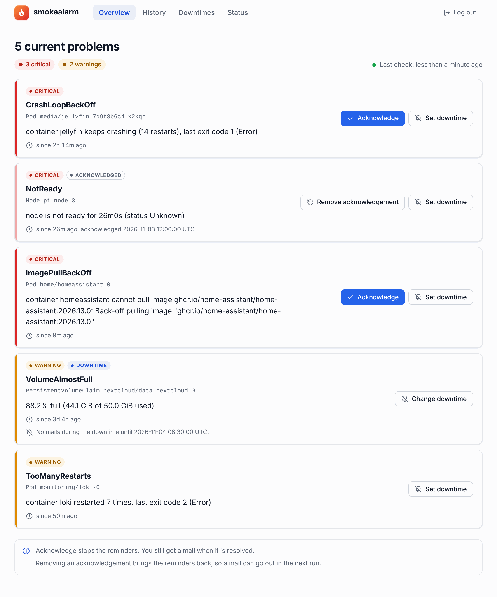
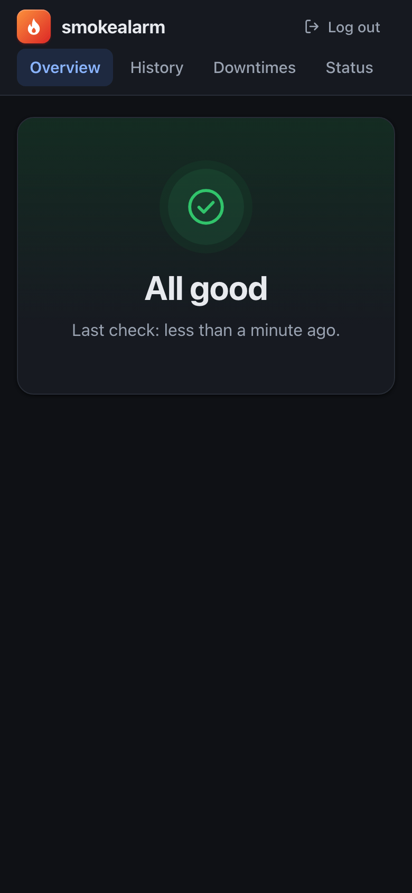
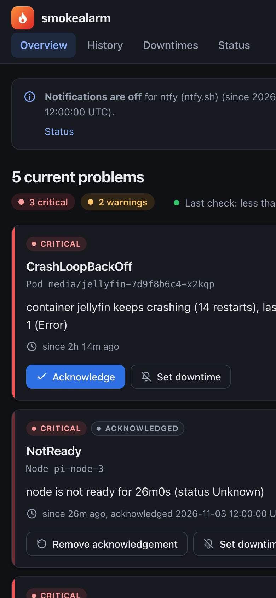
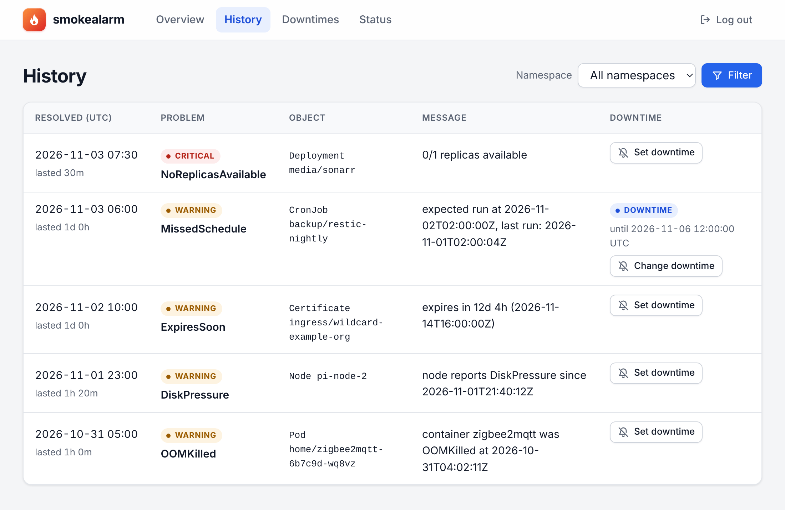
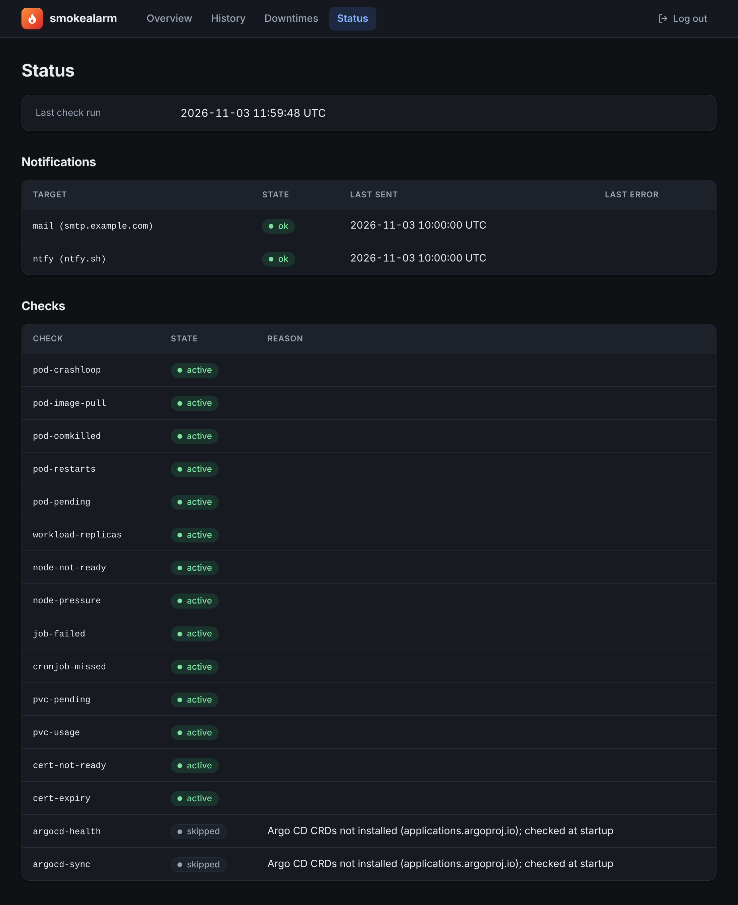

# smokealarm

> A smoke alarm for your Kubernetes cluster – silent until something's on fire.

smokealarm runs inside your cluster and tells you what is broken right now.

It runs a fixed set of checks that need no configuration, and shows current problems and their history on a web page that also works on a phone. When a problem starts or ends, it tells you: by mail, through ntfy, Telegram, Slack or Microsoft Teams, or with a webhook to anything else.



## Scope

The list of checks is short on purpose, so that each one can be reliable. smokealarm has no metrics database, no graphs and no query language, so it won't replace Prometheus. It doesn't collect logs or traces. It also doesn't do root-cause analysis: it can tell you that a pod is crash-looping, but finding out why is up to you.

It was developed and tested with k3s on a Raspberry Pi (arm64). Nothing in it depends on k3s, so it runs on any standard Kubernetes.

## How it works

Every 30 seconds smokealarm runs all checks against its in-memory copy of the cluster state and compares the result with the previous run. A new problem starts as **pending**. If it is still there after `SMOKEALARM_ALERT_AFTER` (2 minutes by default), it becomes **firing** and is reported. When it has been gone for `SMOKEALARM_RESOLVE_AFTER` (5 minutes by default), it is **resolved** and reported again. A problem that disappears before the first wait is over is never reported. A problem that gets worse (warning to critical) is reported again once that has lasted `SMOKEALARM_ALERT_AFTER`. All changes from one run go into a single mail (or message, for the other [notification targets](#notification-targets)).

If you already know about a critical problem, press **Acknowledge** on the overview. It stays on the page with a mark and sends no more reminders. You still get a mail when it is resolved. See [Acknowledging a problem](#acknowledging-a-problem) for the details.

To silence one problem until a fixed time, for example during planned work or while it flaps, set a [downtime](#downtimes).

When a node goes down, the node is the alarm: the problems of the pods and workloads on it are held back instead of arriving one by one. See [When a node is down](#when-a-node-is-down).

[ARCHITECTURE.md](ARCHITECTURE.md) has the details.

## The web interface

The overview shows what is firing right now, critical problems first. For each problem you see the object, the reason, the message from the cluster and how long it has been going on. From there you can acknowledge a critical problem or set a downtime. When nothing is wrong, the page just says "All good".

The pages reload every 30 seconds and work on a phone. Light or dark mode follows your system setting.

<p>
  
  &nbsp;
  
</p>

The history lists resolved problems, newest first, and you can filter it by namespace. They are kept for 30 days by default (`SMOKEALARM_RETENTION`). A problem that keeps coming back can get a downtime from here too.



The status page tells you when the checks last ran, lists every notification target with the time of its last message and its last error, and lists every check. If one can't run, for example because Argo CD isn't installed, the reason is next to it.



A fourth page lists the running downtimes and can end them early. The screenshots show made-up data.

## Installation

You need a Kubernetes cluster, `kubectl` and [Helm](https://helm.sh/) 3 or 4.

### 1. The image

The image contains one static binary and is built for `linux/amd64` and `linux/arm64`. Nothing is published yet, so build it yourself and push it to a registry your cluster can pull from:

```sh
make image IMAGE=ghcr.io/<you>/smokealarm TAG=0.1.0 PUSH=1
```

The multi-arch build needs a buildx builder that supports several platforms; the comment in the [Makefile](Makefile) explains this. To build for your own machine only, use `make image-local`.

### 2. The admin password

There is one local admin user. smokealarm takes the bcrypt hash of the password, not the password itself, so create the hash first:

```sh
read -s PW; printf '%s' "$PW" | docker run -i --rm ghcr.io/<you>/smokealarm:0.1.0 hash-password
```

Without Docker, run `make hash-password` in a checkout. The hash contains `$` characters, so keep it in single quotes or a variable and pass it with `--set-string`, as below.

### 3. Install the chart

```sh
HASH='<the hash from step 2>'
helm install smokealarm ./deploy/helm/smokealarm \
  --namespace smokealarm --create-namespace \
  --set image.repository=ghcr.io/<you>/smokealarm \
  --set-string auth.passwordHash="$HASH"
```

The chart stores the hash in a Kubernetes Secret. To manage the Secret yourself instead:

```sh
kubectl -n smokealarm create secret generic smokealarm-auth \
  --from-literal=SMOKEALARM_ADMIN_PASSWORD_HASH="$HASH"
helm install smokealarm ./deploy/helm/smokealarm -n smokealarm \
  --set image.repository=ghcr.io/<you>/smokealarm --set existingSecret=smokealarm-auth
```

The same Secret can also hold `SMOKEALARM_SMTP_USERNAME` and `SMOKEALARM_SMTP_PASSWORD`.

[`deploy/helm/examples/`](deploy/helm/examples) has values files for common setups: ingress with TLS, mail, minimal permissions, and your own Secret. Pass one with `-f deploy/helm/examples/<file>`. The comment at the top of each file shows the full command.

### 4. Open it

```sh
kubectl -n smokealarm port-forward svc/smokealarm 8080:80
```

Open <http://localhost:8080> and log in as `admin`. By default the login cookie is only sent over HTTPS, so if the login doesn't stick over the port-forward, install with `--set config.cookieSecure=false` for local use. For permanent access, use the ingress:

```yaml
# my-values.yaml
ingress:
  enabled: true
  className: nginx
  host: smokealarm.example.com
  tls:
    enabled: true
    secretName: smokealarm-tls
```

### 5. Mail

Set an SMTP host to turn mail on. Without one, state changes only go to the log.

```yaml
smtp:
  host: smtp.example.com
  port: 587
  tls: starttls            # starttls, tls (port 465) or none (local testing only)
  from: smokealarm@example.com
  to: [me@example.com]
  username: smokealarm     # optional; stored in the Secret together with the password
  password: "..."
```

A mail looks like this:

```
Subject: [smokealarm] CRITICAL: CrashLoopBackOff media/jellyfin

1 new problem

NEW PROBLEMS

[CRITICAL] CrashLoopBackOff
  Object:  Pod media/jellyfin
  Message: container jellyfin keeps crashing (7 restarts), last exit code 137 (Error)
  Since:   2026-11-03 10:00:00 UTC

Details: https://smokealarm.example.com
```

If one run finds several changes, the subject is a count (`[smokealarm] 3 new problems, 1 resolved`) and the body lists all of them, critical problems first. A problem you were already told about triggers a new mail if it becomes critical. Set `SMOKEALARM_CRITICAL_REPEAT_INTERVAL` (chart: `config.criticalRepeatInterval`) to be reminded of critical problems that are still open: each one is reported again as `[smokealarm] STILL CRITICAL: ...` once its last report is that old. Warnings are not repeated. If the mail server is down, smokealarm tries again on the next run, even after a restart.

### 6. Other notification targets

Besides mail, or instead of it, smokealarm can send to ntfy, Telegram, Slack, Microsoft Teams and a webhook. See [Notification targets](#notification-targets) for how to set each one up.

## Notification targets

Every target that is set up gets every notification, unless you [route](#routing) them. You can use any combination, mail included. Without any, notifications only go to the log. The targets only change *where* a notification goes: `SMOKEALARM_ALERT_AFTER`, the combined message per run, reminders, acknowledgements and downtimes work the same for all of them, and whatever this README says about "mail" applies to each target.

Each target remembers on its own what it has been told. If one is down (say Telegram for an hour), only that one is tried again on the next runs, also after a restart, and the others get nothing twice. It also has its own reminder clock, which runs from its own last message. A target you add later doesn't get the history, but at its first run it hears about every problem that is firing and not acknowledged, like a target that has just learned of them. A target you remove is forgotten; if you add it back, it counts as new again. The very first start after upgrading from a version without targets takes over what the old version already reported, so nothing is sent twice; a target you add in that same step only hears what comes next.

The chat targets (ntfy, Telegram, Slack, Teams) get a short message: the mail subject as the headline, then one line per problem with object, reason and since when, and the link to the web UI (`SMOKEALARM_BASE_URL`). If there are more problems than fit into one message, the last line says `… and 12 more, see <link>`. The limits are 4096 bytes for ntfy and Telegram, 3000 characters for Slack and about 26 KB for the whole Teams card. A message looks like this:

```
[smokealarm] 2 new problems, 1 resolved

New:
- CRITICAL Pod media/jellyfin: CrashLoopBackOff (since 2026-11-03 10:00 UTC)
- WARNING Deployment media/sonarr: ReplicasUnavailable (since 2026-11-03 10:30 UTC)
Resolved:
- Node pi-2: NotReady (since 2026-11-03 10:00 UTC, resolved 2026-11-03 12:30 UTC)

https://smokealarm.example.com
```

Tokens and webhook URLs are secrets: whoever has one can post to your channel. The Helm chart stores them in its Secret (or reads them from `existingSecret`), never as plain values in the Deployment. They never appear in the log, in error messages or on the status page; the status page only shows the name of the target, such as `slack`, `webhook`, `ntfy` or `telegram (chat -1001234567890)`.

All URLs must use `https`. Plain `http` is accepted for `localhost`, and for the webhook and the ntfy server also with `SMOKEALARM_NOTIFY_ALLOW_HTTP=true` (chart: `notifications.allowHttp`), for a relay inside the cluster. smokealarm does not follow redirects: a webhook that answers with one is reported as an error. The pod needs outgoing HTTPS to the services you use; `HTTPS_PROXY` is honored.

Other services, such as Discord, Matrix, Pushover, Gotify or PagerDuty, have no built-in target. Point the [webhook](#webhook) at a relay such as [Apprise](https://github.com/caronc/apprise-api) or [n8n](https://n8n.io) that forwards to them.

### Routing

By default every target hears about every problem. Two settings change that, and they can be combined.

**Critical problems only, per target.** `SMOKEALARM_<TARGET>_MIN_SEVERITY=critical` sends only critical problems to that target (chart: `minSeverity` under `smtp` and under each target in `notifications`). `<TARGET>` is `SMTP`, `WEBHOOK`, `NTFY`, `TELEGRAM`, `SLACK` or `TEAMS`; for Telegram it applies to all chats. For example, critical problems to the phone with ntfy, everything to Slack:

```
SMOKEALARM_NTFY_MIN_SEVERITY=critical
```

**Per app or namespace, with annotations.** Put these on an object or on its namespace. The one on the object wins; each annotation is looked up on its own. For pods, setting them in the pod template is enough.

| Annotation | Value | Effect |
|---|---|---|
| `smokealarm.gagaschu.github.io/targets` | Comma-separated: `mail`, `webhook`, `ntfy`, `telegram`, `slack`, `teams` | Its problems go only to these targets. `telegram` means all chats. |
| `smokealarm.gagaschu.github.io/severity` | `warning` or `critical` | Replaces the severity of all its problems. |

```yaml
apiVersion: v1
kind: Namespace
metadata:
  name: media
  annotations:
    smokealarm.gagaschu.github.io/targets: "slack"      # the media team's channel only
    smokealarm.gagaschu.github.io/severity: "warning"   # never wake anybody up for it
```

A target hears about a problem if the problem's severity is high enough for it **and** the targets annotation, if there is one, names it. Good to know:

- **A typo does not silence an alarm.** If the targets annotation names no target that is configured (`slak`), the problem goes to every target. Names that are not configured are logged as a warning, once, naming the object or namespace that carries the annotation, and so is a severity that is neither `warning` nor `critical`; that one is ignored and the check's severity counts.
- **A warning can reach nobody, on purpose.** With `targets: ntfy` and `SMOKEALARM_NTFY_MIN_SEVERITY=critical`, warnings of that object go nowhere. That is allowed, but logged once as a warning, and the overview says "Notifies nobody".
- **The end goes to whoever heard the start.** The filter applies to new problems and reminders. A target that was told about a problem is also told when it is resolved, even if the problem has become a warning or the annotation has changed since. That also holds when the problem gets worse or a downtime ends: only the targets it is meant for now hear it again as new, the others still hear the end.
- **Changing an annotation does not create a new problem.** It counts from the next run. A target that now gets the problem and has not heard of it yet hears about it as new; one that no longer gets it gets no more reminders.
- **Getting worse reaches more targets.** A warning that becomes critical (`pvc-usage`, `cert-expiry`, `workload-replicas`, or `severity: critical` set later) is reported as new to the critical-only targets.
- The severity annotation goes through all the usual rules: `critical` brings reminders and the acknowledge button, `warning` means a `pvc-usage` or `cert-expiry` problem stays a warning however bad it gets.
- Like the ignore annotation, a problem reads the annotations of its own object: a pod problem those of the pod, a `workload-replicas` problem those of the Deployment (its `metadata`, not the pod template). For a CronJob, those of its job template count too. The namespace is the easy way to cover all of them.
- Acknowledgements and downtimes work as before. The overview and the history say who is notified when it is not every target ("Notifies only: slack" or "Notifies nobody"), and the status page shows which targets get critical problems only.

### ntfy

[ntfy](https://ntfy.sh) sends push notifications to phones and browsers. You subscribe to a *topic* in the app; smokealarm publishes to it.

1. Pick a topic name that is hard to guess, for example `smokealarm-` followed by random characters (`openssl rand -hex 8`). On the public server ntfy.sh, anybody who knows the topic can read along, so treat the name like a password.
2. Subscribe to it in the ntfy app or on <https://ntfy.sh/app>.
3. Set it in the chart:

```yaml
notifications:
  ntfy:
    topic: smokealarm-3f9c2a17b04e5d68   # goes into the Secret
    # server: https://ntfy.example.org   # your own server; empty means https://ntfy.sh
    # token: tk_...                      # an access token, if the server needs one
```

On a self-hosted server with access control, create a token (`ntfy token add <user>`) and set `token` (`SMOKEALARM_NTFY_TOKEN`); it is sent as `Authorization: Bearer`. The message gets the mail subject as its title and a click action to the web UI. Its priority follows what it reports: **urgent** if there is a new critical problem (so it gets through), **high** for reminders only (you already know, but it is still on fire), **default** for new warnings, and **low** if everything is resolved.

### Telegram

1. Talk to [@BotFather](https://t.me/BotFather) in Telegram, send `/newbot` and follow the questions. At the end you get a token like `123456789:AAH...`.
2. Start a chat with your new bot and send it any message. To use a group instead, add the bot to the group and send a message there. For a channel, add the bot as an administrator.
3. Find the chat id: open `https://api.telegram.org/bot<token>/getUpdates` in a browser and look for `"chat":{"id":...}`. Groups have negative ids (`-100...`). A public channel can also be given as `@channelname`.
4. Set both in the chart. Several chat ids are possible, and each chat is retried on its own. **Write the ids in quotes**, because Helm turns bare numbers into floats (the chart refuses them):

```yaml
notifications:
  telegram:
    botToken: "123456789:AAH..."              # goes into the Secret
    chatIds: ["-1001234567890", "987654321"]
```

The message is plain text, so names with `_` or `<` need no escaping. The token is part of the request URL, which smokealarm never logs.

### Slack

1. Create a Slack app at <https://api.slack.com/apps> ("From scratch"), open **Incoming Webhooks**, switch them on and choose **Add New Webhook to Workspace** with the channel.
2. Copy the webhook URL (`https://hooks.slack.com/services/...`) into the chart:

```yaml
notifications:
  slack:
    webhookUrl: https://hooks.slack.com/services/T000/B000/XXXX   # goes into the Secret
```

The message has the subject as its header and the problem list below it.

### Microsoft Teams

Teams is reached through a **Power Automate Workflows** webhook. The old Office 365 connector webhooks (`https://<tenant>.webhook.office.com/...`) were switched off by Microsoft and no longer work; smokealarm refuses such a URL at startup.

1. In Teams, open the channel, choose **⋯ → Workflows**, and pick the template **Post to a channel when a webhook request is received**.
2. Follow the steps (team and channel). At the end, copy the URL it shows (`https://...logic.azure.com/workflows/...` or `https://...powerplatform.com/...`).
3. Set it in the chart:

```yaml
notifications:
  teams:
    webhookUrl: "https://prod-01.westeurope.logic.azure.com/workflows/..."   # goes into the Secret
```

smokealarm posts an Adaptive Card with the subject, the problem list and a button to the web UI. Workflows answers `202 Accepted`, and the card can take a few seconds to show up.

### Webhook

The generic webhook posts every notification as JSON to a URL of your choice. Use it for your own automation, or for a relay that forwards to services without a built-in target.

```yaml
notifications:
  webhook:
    url: https://relay.example.org/hooks/smokealarm   # goes into the Secret
    header: "Authorization: Bearer <token>"           # optional, goes into the Secret
```

`header` (`SMOKEALARM_WEBHOOK_HEADER`) is one extra header of the form `Name: value`, usually for authentication. Any `2xx` answer counts as delivered. The request is a `POST` with `Content-Type: application/json`:

```json
{
  "version": 1,
  "subject": "[smokealarm] 1 new problem, 1 resolved",
  "base_url": "https://smokealarm.example.com",
  "counts": { "new": 1, "reminders": 0, "resolved": 1 },
  "new": [
    {
      "key": "pod-crashloop/Pod/media/jellyfin/CrashLoopBackOff",
      "check": "pod-crashloop",
      "severity": "critical",
      "object": { "kind": "Pod", "namespace": "media", "name": "jellyfin" },
      "reason": "CrashLoopBackOff",
      "message": "container jellyfin keeps crashing (7 restarts), last exit code 137 (Error)",
      "since": "2026-11-03T10:00:00Z",
      "resolved_at": null,
      "affected": []
    }
  ],
  "reminders": [],
  "resolved": [
    {
      "key": "node-not-ready/Node//pi-2/NotReady",
      "check": "node-not-ready",
      "severity": "critical",
      "object": { "kind": "Node", "namespace": "", "name": "pi-2" },
      "reason": "NotReady",
      "message": "node is not ready for 10m0s (status Unknown): Kubelet stopped posting node status.",
      "since": "2026-11-03T10:00:00Z",
      "resolved_at": "2026-11-03T12:30:00Z",
      "affected": []
    }
  ]
}
```

- `version` changes only if a field is removed or changes its meaning. New fields may be added at any time, so ignore the ones you don't know.
- `new`, `reminders` and `resolved` are always lists, possibly empty. `reminders` are critical problems that are still open (see `SMOKEALARM_CRITICAL_REPEAT_INTERVAL`).
- `key` identifies the problem across messages; the same key in `resolved` ends what an earlier `new` started.
- `affected` is always a list. For a `node-not-ready` problem in `new` or `reminders`, it holds the problems the node holds back (`object` and `reason`, see [When a node is down](#when-a-node-is-down)); otherwise it is empty.
- Times are RFC 3339 in UTC. `resolved_at` is `null` unless the problem is resolved. `namespace` is empty for cluster-scoped objects such as nodes. `base_url` is empty if `SMOKEALARM_BASE_URL` is not set.

## When a node is down

A node that fails takes its pods with it, and their Deployments, StatefulSets and DaemonSets soon miss replicas. smokealarm reports the cause, not the noise:

- The mail subject starts with the node: `[smokealarm] NODE DOWN: pi-2`, with any other changes counted after it, e.g. `[smokealarm] NODE DOWN: pi-2 (+ 1 new problem, 1 resolved)`. The body starts with a section **NODE DOWN**; chat messages start with "Node down:". Up to three nodes are named, the rest are counted.
- **Problems caused by the node are held back.** A problem of a pod on the node, or of a Deployment, StatefulSet or DaemonSet that misses no more replicas than it has pods on the node, is not reported while the node is down, however long that takes. The NotReady message lists them as "Affected" (as far as the target would hear about them), a reminder lists the current ones, and the overview shows them grouped below the node.
- **When the node is back**, or the node no longer explains a held-back problem (a DaemonSet that now fails on the healthy nodes too), it gets the usual `SMOKEALARM_ALERT_AFTER` from then on. Pods usually become ready again in that time, and nothing more is sent than the "resolved" of the node. A problem that lasts longer is reported as a problem of its own.
- **Not held back:** pods that have no node yet (Pending, for example because the other nodes have no room left for them). That is a problem of its own and reported as usual. A problem that was already reported before the node went down also goes on as before, with its reminders and its "resolved".
- **The node's own annotations decide about its alarm**, not those of the pods on it. A test node can be silenced with `smokealarm.gagaschu.github.io/ignore: "true"`, or sent elsewhere with the [routing](#routing) annotations. Its consequences are held back all the same, so a test node that fails does not alarm through its pods either.

```
kubectl annotate node pi-test smokealarm.gagaschu.github.io/ignore=true
```

A node counts as down when its Ready condition is `False` or `Unknown`, as for the `node-not-ready` check. Being held back is decided per problem and in every run: a Deployment that misses only its pod on the failed node is held back, while a pod of it that crashes on another node is reported. If `node-not-ready` is switched off, nothing is held back, because nobody would hear about the node. A node that is removed from the cluster counts as back.

## When the API cannot be read

smokealarm works on its own copy of the cluster, which the Kubernetes API keeps up to date. If that stops, the copy gets old without anything looking wrong. So smokealarm watches for it:

- **The check `api-connection`** reports a critical problem once the API server has not answered, or a watch has been failing, for 3 minutes. With `SMOKEALARM_ALERT_AFTER` that makes 5 minutes by default, so a restart of the API server is no alarm. Its message names the last error.
- **If nothing can be read**, all other checks count as unknown: their problems stay as they are and send no reminders, and the status page gives the reason. They are judged again as soon as there is fresh data. New problems stay unseen until then.
- **If only a part fails** (a missing permission, a CRD that was deleted), the other checks run as usual and only the alarm tells about it. Findings about the failing part may be out of date.
- **The overview** shows a notice with the start at the top and no longer says "All good". `/readyz` does not change, because a new pod would not help.

**How long it takes.** A permission that is removed does not end a watch that is already open. It only shows when that watch ends, which takes 5 to 10 minutes, so the notice comes after 8 to 13 minutes and the alarm after 10 to 15 (with `SMOKEALARM_ALERT_AFTER` at 2 minutes). When the API server answers again after an outage, the outage is over at once. If it answers but some watches still fail, each of those counts as working again 2 minutes after its last error, because Kubernetes' client library does not report that it recovered, so the notice and the alarm can last that much longer than the failure. If all watches are affected, the other checks stay paused for that time too. If it answers again and a watch still fails for a lasting reason, its 3 minutes start over from then.

The alarm can only go out if the notification target can be reached without the cluster. Like every other problem, the alarm is resolved after `SMOKEALARM_RESOLVE_AFTER`. If smokealarm is restarted during an outage, it cannot start until the API is back, and the pod is restarted until then.

## Acknowledging a problem

Only firing critical problems can be acknowledged. Warnings are not repeated anyway.

- An acknowledged problem sends no reminders, and the mark lasts until the problem is resolved or until you remove it.
- "Resolved" is always reported, even if the first mail never went out. A first mail that is still waiting, for example during a mail server outage, is dropped once the problem is acknowledged. If you have several recipients, the others then only hear about it from the "resolved" mail.
- If an acknowledged problem becomes a warning and then critical again, it stays acknowledged and no mail is sent.
- If the problem returns after "resolved", it is a new alarm with a new mail.
- **Remove acknowledgement** takes it back, and the problem behaves like any other again. A reminder that is overdue, or a first mail that was held back, goes out in the next run, unless a downtime is running. If the problem is only a warning at that moment, nothing is sent until it is critical again, and only then can you acknowledge it again.

An acknowledgement covers one problem, identified by its key: check, object and reason. Only `pvc-usage`, `cert-expiry` and `workload-replicas` keep their key when the reason changes. For the other checks a new reason counts as a new problem, and so does a new object name, such as a pod that was recreated by its Deployment. The new problem gets its own mail and is not acknowledged.

## Downtimes

A downtime silences one problem, warning or critical, until a fixed date and time. Set it from the overview or, if the problem is resolved right now, from the history. The **Downtimes** page lists the running ones, and you can end them early there. Times are entered and shown in UTC, like in the mails, and the end must be in the future. A new downtime for the same problem replaces the old one.

- While it runs, the problem sends no mail: not when it is new, no reminder and no "resolved". It stays visible in the web UI, with a mark.
- If the problem is still active when the downtime ends, you get a mail in the next run, and the reminder interval runs from that mail. Ending a downtime early works the same way.
- If the problem went away during the downtime, nothing is sent, not even after it ends. If it returns after the end, it is a new alarm with a new mail.
- A downtime wins over an acknowledgement while it runs: an acknowledged problem that goes away during a downtime sends no "resolved". An acknowledgement outlasts a downtime: if the problem is still active when the downtime ends, no mail is sent, and "resolved" is reported later.
- If a check cannot run when the downtime ends, for example because the kubelet does not answer, the mail waits until the check runs again.

A downtime covers exactly one problem, like an acknowledgement: the same check, object and reason. A new reason is a new problem, except for `pvc-usage`, `cert-expiry` and `workload-replicas`. A new object name is a new problem too. **A pod recreated by its Deployment gets a new name, so a downtime on its `pod-crashloop` problem no longer covers it, and it sends mail as usual.** A downtime on the Deployment's `workload-replicas` problem keeps working, but it does not silence the problems of the pods themselves.

## Configuration

All configuration is done through environment variables starting with `SMOKEALARM_`. The Helm chart sets them from its [values.yaml](deploy/helm/smokealarm/values.yaml). Invalid values stop the program at startup with an error message. Durations use Go syntax (`30s`, `5m`, `2h`) plus `d` for days (`30d`).

| Variable | Default | Description |
|---|---|---|
| `SMOKEALARM_ADMIN_USER` | – (required) | Name of the admin user. |
| `SMOKEALARM_ADMIN_PASSWORD_HASH` | – (required) | bcrypt hash of the admin password. Create it with `smokealarm hash-password`. |
| `SMOKEALARM_CHECK_INTERVAL` | `30s` | How often the checks run. |
| `SMOKEALARM_ALERT_AFTER` | `2m` | How long a problem must last before it is reported. `0s` reports at once. |
| `SMOKEALARM_RESOLVE_AFTER` | `5m` | How long a reported problem must be gone before it counts as resolved and that is reported. `0s` resolves it at once. |
| `SMOKEALARM_CRITICAL_REPEAT_INTERVAL` | `0s` | How often a critical problem that is still open is reported again, for example `4h`. `0s` means never. Otherwise it must be at least `SMOKEALARM_CHECK_INTERVAL`. Critical problems that have been open for longer are reported on the next run after you turn this on. |
| `SMOKEALARM_RETENTION` | `30d` | How long resolved problems are kept in the history. |
| `SMOKEALARM_DB_PATH` | `smokealarm.db` | The SQLite database file. The container image uses `/data/smokealarm.db`. |
| `SMOKEALARM_LISTEN_ADDR` | `:8080` | Address of the web server. |
| `SMOKEALARM_BASE_URL` | – | Public URL of the web UI, used for the link in mails. |
| `SMOKEALARM_LOG_FORMAT` | `auto` | `json`, `text` or `auto` (JSON inside a cluster, text otherwise). |
| `SMOKEALARM_LOG_LEVEL` | `info` | `debug`, `info`, `warn` or `error`. |
| `SMOKEALARM_DISABLED_CHECKS` | – | Comma-separated check names to switch off, for example `pod-restarts,pvc-usage`. An unknown name is an error. Open problems of a switched-off check are closed and reported as resolved, see [The checks](#the-checks). |
| `SMOKEALARM_IGNORE_NAMESPACES` | – | Comma-separated namespaces that never produce findings. |
| `SMOKEALARM_RESTART_THRESHOLD` | `5` | `pod-restarts` reports containers with more restarts than this. |
| `SMOKEALARM_POD_PENDING_AFTER` | `5m` | `pod-pending` reports pods that are pending longer than this. |
| `SMOKEALARM_PVC_PENDING_AFTER` | `5m` | `pvc-pending` reports claims that are pending longer than this. |
| `SMOKEALARM_CRONJOB_GRACE` | `5m` | How late a CronJob run may be before `cronjob-missed` reports it. |
| `SMOKEALARM_CRONJOB_TIME_ZONE` | (UTC) | The time zone the Kubernetes controller reads schedules in, for CronJobs without `spec.timeZone`, for example `Europe/Berlin`. See the note below. |
| `SMOKEALARM_KUBELET_CA_FILE` | (the CA of the API client) | A PEM file with the CA that signed the kubelet serving certificates, for `pvc-usage`. Only needed if that is not the CA of the service account (`ca.crt`). The chart sets it from `kubelet.caConfigMap`. See [Volume usage and the kubelet](#volume-usage-and-the-kubelet). |
| `SMOKEALARM_SESSION_TTL` | `7d` | How long a login stays valid. |
| `SMOKEALARM_COOKIE_SECURE` | `true` | Send the login cookie only over HTTPS. Set `false` only for local development over plain HTTP. |
| `SMOKEALARM_SMTP_HOST` | – | Mail server. Setting it switches mail on. |
| `SMOKEALARM_SMTP_PORT` | `587` | Mail server port. |
| `SMOKEALARM_SMTP_TLS` | `starttls` | `starttls`, `tls` (encrypted from the start, usually port 465) or `none` (local testing only; a login is then only possible to `localhost`). With `starttls`, a server that does not offer it is an error; there is no silent downgrade. |
| `SMOKEALARM_SMTP_USERNAME` | – | Login for the mail server (optional). |
| `SMOKEALARM_SMTP_PASSWORD` | – | Password for the login. Required if a username is set. |
| `SMOKEALARM_SMTP_FROM` | – (required if mail is on) | Sender address. |
| `SMOKEALARM_SMTP_TO` | – (required if mail is on) | Comma-separated recipient addresses. |
| `SMOKEALARM_WEBHOOK_URL` | – | Secret. Webhook URL; setting it switches the [webhook](#webhook) on. |
| `SMOKEALARM_WEBHOOK_HEADER` | – | Secret. One extra header for the webhook, `Name: value`, e.g. `Authorization: Bearer <token>`. |
| `SMOKEALARM_NTFY_TOPIC` | – | Secret. The [ntfy](#ntfy) topic; setting it switches ntfy on. Letters, digits, `-` and `_`. |
| `SMOKEALARM_NTFY_URL` | `https://ntfy.sh` | The ntfy server, for a self-hosted one. |
| `SMOKEALARM_NTFY_TOKEN` | – | Secret. Access token for the ntfy server (optional). |
| `SMOKEALARM_TELEGRAM_BOT_TOKEN` | – | Secret. The bot token from @BotFather; setting it switches [Telegram](#telegram) on. |
| `SMOKEALARM_TELEGRAM_CHAT_IDS` | – (required if Telegram is on) | Comma-separated chat ids (numbers such as `-1001234567890`) or `@channelname`s. |
| `SMOKEALARM_SLACK_WEBHOOK_URL` | – | Secret. A Slack incoming webhook URL; setting it switches [Slack](#slack) on. |
| `SMOKEALARM_TEAMS_WEBHOOK_URL` | – | Secret. A Teams Workflows webhook URL; setting it switches [Teams](#microsoft-teams) on. Old `webhook.office.com` connector URLs are refused. |
| `SMOKEALARM_NOTIFY_ALLOW_HTTP` | `false` | Allow plain `http://` for the webhook and the ntfy server, e.g. a relay in the cluster. `localhost` is always allowed. |
| `SMOKEALARM_SMTP_MIN_SEVERITY` | `warning` | `critical` sends only critical problems by mail. See [Routing](#routing). Like the following five, refused if the target is not configured. |
| `SMOKEALARM_WEBHOOK_MIN_SEVERITY` | `warning` | The same for the webhook. |
| `SMOKEALARM_NTFY_MIN_SEVERITY` | `warning` | The same for ntfy. |
| `SMOKEALARM_TELEGRAM_MIN_SEVERITY` | `warning` | The same for Telegram, all chats. |
| `SMOKEALARM_SLACK_MIN_SEVERITY` | `warning` | The same for Slack. |
| `SMOKEALARM_TEAMS_MIN_SEVERITY` | `warning` | The same for Teams. |
| `SMOKEALARM_TEMPLATE_DIR` | – | A directory with your own message templates for the subject and text of mail, ntfy, Telegram, Slack and Teams. Empty means the built-in messages. The chart sets it from `templates`. See [Message templates](#message-templates). |

For local runs, smokealarm also reads the standard `KUBECONFIG` variable. In a pod it uses the service account.

## The checks

Severity is either critical (act now) or warning (have a look soon). The status page shows which checks are active and why any are skipped.

| Check | Severity | Reports |
|---|---|---|
| `pod-crashloop` | critical | A container is in `CrashLoopBackOff`. (The kubelet shows this state only after several crashes, so it can take a few minutes.) |
| `pod-image-pull` | critical | A container cannot pull its image (`ImagePullBackOff` / `ErrImagePull`). |
| `pod-oomkilled` | warning | A container was killed for exceeding its memory limit in the last 15 minutes. |
| `pod-restarts` | warning | More restarts than `SMOKEALARM_RESTART_THRESHOLD`, with the last restart within the past hour. |
| `pod-pending` | warning | A pod has been pending longer than `SMOKEALARM_POD_PENDING_AFTER`; the message says why (for example `Unschedulable`). |
| `workload-replicas` | warning / critical | A Deployment, StatefulSet or DaemonSet has fewer available replicas than desired (warning), or none at all (critical). |
| `node-not-ready` | critical | A node is `NotReady` or stopped reporting. |
| `node-pressure` | warning | A node reports `MemoryPressure`, `DiskPressure` or `PIDPressure`. |
| `job-failed` | warning | A Job failed. For CronJobs only the newest Job counts, so old failures do not alarm forever. |
| `cronjob-missed` | warning | A scheduled CronJob run did not happen (suspended CronJobs are ignored). |
| `pvc-pending` | warning | A claim is pending longer than `SMOKEALARM_PVC_PENDING_AFTER`. Claims of a `WaitForFirstConsumer` storage class are skipped, because they stay pending until a pod uses them. |
| `pvc-usage` | warning / critical | A volume is more than 85 % (warning) or 95 % (critical) full. Asks the kubelets directly and needs `get` on `nodes/stats`; see [Volume usage and the kubelet](#volume-usage-and-the-kubelet). |
| `cert-not-ready` | warning | A cert-manager Certificate is not `Ready`. Only if cert-manager is installed. |
| `cert-expiry` | warning / critical | A certificate expires in less than 14 days (warning) or 3 days (critical), or has expired. Only if cert-manager is installed. |
| `argocd-health` | critical | An Argo CD Application is `Degraded` or `Missing`. Only if Argo CD is installed. |
| `argocd-sync` | warning | An Argo CD Application is `OutOfSync`. Only if Argo CD is installed. |
| `api-connection` | critical | smokealarm has been unable to keep its copy of the cluster up to date for 3 minutes: the API server does not answer, or a watch fails (a missing permission, a deleted CRD). See [When the API cannot be read](#when-the-api-cannot-be-read). |

Notes:

- The cert-manager and Argo CD CRDs are detected once at startup, and only if an enabled check needs them. If a CRD is missing or the service account may not list it, the matching checks are skipped and the status page says why. After installing the CRD or granting the permission, restart smokealarm. While a permission is missing, open problems from those checks stay open, since they may still exist. If the CRD is not installed, they count as gone.
- Disabling a check closes its problems. This applies to `SMOKEALARM_DISABLED_CHECKS` and to the chart's `rbac.*` switches, which disable the checks that need the permission. The open problems are reported as resolved after `SMOKEALARM_RESOLVE_AFTER`, even if the cause is still there. A check that is only skipped for a moment, for example because the kubelet doesn't answer, leaves its problems alone.
- `pvc-usage`, `cert-expiry` and `workload-replicas` can go from warning to critical. It stays the same problem: it isn't reported as resolved, and you get a new mail saying it is now critical, once that has lasted `SMOKEALARM_ALERT_AFTER`.
- A CronJob without `spec.timeZone` runs in the local time of the Kubernetes controller. On k3s the controller runs inside the host process, so that should be the host's time zone (check with `timedatectl`). smokealarm cannot see it from the API and assumes UTC. If the host is not on UTC, set `SMOKEALARM_CRONJOB_TIME_ZONE` to the same zone, or daily and weekly CronJobs are reported as missed most of the day. Short schedules like `*/5 * * * *` are not affected.
- A schedule that never comes true, like `0 0 31 2 *` for a CronJob that only runs by hand, is never reported as missed.
- `pvc-usage` looks at the filesystem a volume lives on, because that is what the kubelet reports. With k3s `local-path` that is the node's disk, and the requested size is not enforced, so the check only fires when the node disk is nearly full. It is more useful for volumes with their own filesystem (Longhorn, Ceph, block volumes).
- If `pvc-usage` can't read the volume stats (no permission, a node doesn't answer, a certificate can't be verified), it is skipped for that run, open problems stay open, and the status page shows the reason.
- While a node is down it can't be asked. A `pvc-usage` problem whose volume isn't measured then stays open, because the volume may live on that node. It also stays open if its pod is deleted meanwhile, until all nodes are back.

### Ignoring things

- Put the annotation `smokealarm.gagaschu.github.io/ignore: "true"` on an object or its namespace to silence all its findings. For pods, setting it in the pod template of the Deployment, StatefulSet, Job and so on is enough.
- List namespaces in `SMOKEALARM_IGNORE_NAMESPACES`.
- Switch off a whole check with `SMOKEALARM_DISABLED_CHECKS`.
- To change where the problems of an app go, or how severe they are, without silencing them, see [Routing](#routing).

## Security

smokealarm only needs `get`, `list` and `watch` on a short list of resources, and the `ClusterRole` from the Helm chart grants just that, plus `get` on `nodes/stats` for the volume usage. It never reads Secrets. The optional permissions each have a switch: `rbac.nodesStats` for `pvc-usage`, `rbac.certManager` for cert-manager Certificates and `rbac.argocd` for Argo CD Applications. Turning a switch off disables the checks that need it. The ClusterRole is named `<namespace>-<release>`, so the chart can be installed in several namespaces.

`nodes/stats` grants resource statistics only: no logs, no command execution, no list of pods. smokealarm used to read the stats through the API server, which needs `get` on `nodes/proxy`, and the Kubernetes documentation ([RBAC good practices](https://kubernetes.io/docs/concepts/security/rbac-good-practices/#access-to-proxy-subresource-of-nodes)) warns that this reaches the whole kubelet API. It now asks the kubelets itself and never needs `nodes/proxy`. The rule only exists while `pvc-usage` is active. If you don't need the check, set `rbac.nodesStats=false` or add `pvc-usage` to `disabledChecks`, and the permission goes away. Values files that still set the old `rbac.nodesProxy` are refused with a hint.

### Volume usage and the kubelet

`pvc-usage` calls `https://<node InternalIP>:<kubelet port>/stats/summary` on every Ready node (the port the node publishes, usually 10250) with the service account token. The kubelet checks the token and the permission itself. That needs three things from the cluster; if one is missing, the check is skipped and the status page says which:

- **The kubelet port must be reachable from the smokealarm pod.** A NetworkPolicy or a host firewall can block it. Through the API server this was never a question. Status page: "could not reach the kubelet of node …".
- **The kubelet's certificate must be verifiable.** smokealarm always verifies it, against the CA of the service account (`ca.crt`) unless `SMOKEALARM_KUBELET_CA_FILE` is set. On k3s the kubelet serving certificates are signed by the cluster's server CA. On kubeadm clusters they are self-signed unless `serverTLSBootstrap: true` is set in the kubelet configuration (and the certificate requests are approved); with self-signed certificates `pvc-usage` can't run, and smokealarm deliberately does not skip the verification, because the token would go to anybody who answers at the node IP. If your kubelet certificates come from another CA, put it into a ConfigMap and set `kubelet.caConfigMap` (see [values.yaml](deploy/helm/smokealarm/values.yaml)). Status page: "could not verify the TLS certificate of the kubelet on node …". The certificate must also contain the node's InternalIP; otherwise the status page says it "does not name the address smokealarm calls".
- **The kubelet must use webhook authentication and authorization** (`authentication-token-webhook` and `authorization-mode=Webhook`, the default on k3s and kubeadm). Otherwise it answers 401 or 403, as it does when `nodes/stats` is missing. Status page: "the kubelet of node … refused the request", followed by the kubelet's own answer, which names the user and subresource it checked.

The kubelets are always called directly: `HTTPS_PROXY` applies to the notification targets only. A kubelet that takes longer than 10 seconds is reported as "did not answer in time". With `helm upgrade --reuse-values` from a release before this change, the chart stops with a hint about `rbac.nodesProxy`; use `--reset-then-reuse-values` instead.

The container runs as non-root with a read-only root filesystem, all capabilities dropped, no privilege escalation and the default seccomp profile. It can only write to the data volume.

There is one local admin, with the password stored as a bcrypt hash. Sessions are kept in the database, which stores only a hash of the session id. The cookie is `HttpOnly` and `SameSite=Lax`, and `Secure` unless you turn that off. Failed logins are limited to 5 per 15 minutes per client address. A session ends when the password or the admin user changes.

Behind an Ingress or another proxy, all clients have the same address and share one limit. Five wrong logins by anybody then block the login for everybody for up to 15 minutes, and somebody who repeats that can keep you locked out. Existing sessions keep working. So don't expose the UI to the internet without restricting access first, for example with an allowlist or authentication at the Ingress, or a VPN.

Actions that change state, such as acknowledging a problem or setting a downtime, need a valid session and refuse requests that come from another site or another host of the same domain (Go's `http.CrossOriginProtection`). Your proxy has to pass on the original `Host` header if you use plain HTTP, otherwise these actions fail with 403. Over HTTPS, browsers send a `Sec-Fetch-Site` header and the `Host` does not matter.

Passwords, hashes, session ids, tokens and webhook URLs are never logged.

`/healthz` and `/readyz` need no login, so Kubernetes can probe them.

## Local development

You need Go (the version in [go.mod](go.mod)), `golangci-lint`, and for the image and chart tasks Docker and Helm.

```sh
make test        # go vet and all tests, including the chart tests (skipped without helm)
make test-race   # the same with the race detector (on Linux this needs a C compiler)
make lint        # golangci-lint
make build       # bin/smokealarm
make chart       # lint and render the Helm chart: the defaults and every file in deploy/helm/examples
make screenshots # take the images in docs/screenshots again (needs Chrome or Chromium, and pngquant)

export SMOKEALARM_ADMIN_PASSWORD_HASH="$(make -s hash-password)"
make run         # runs against the cluster from KUBECONFIG, UI on http://localhost:8080
```

`make run` sets the user to `admin` and uses plain-text logs and a cookie that works over HTTP. `pvc-usage` then calls the kubelets from your machine, with the credentials of your kubeconfig, so the node IPs must be reachable from there; otherwise the check is skipped with the reason on the status page. The variables above override all of this. To try it out, use a throw-away cluster or namespace. For example, `kubectl create deployment brokendep --image=does-not-exist/nope` produces a critical finding after `SMOKEALARM_ALERT_AFTER`.

`make help` lists all tasks. The code is meant to be readable without knowing Go; [ARCHITECTURE.md](ARCHITECTURE.md) is the place to start.

## Troubleshooting

- **The pod restarts about two minutes after it starts; the log says `informer caches did not sync within 2m0s: <resources>` and, before that, `forbidden`.** smokealarm can't read the listed resources. The Helm chart grants them, so this happens with `rbac.create=false` and your own RBAC. Compare yours with `deploy/helm/smokealarm/templates/clusterrole.yaml`. Missing cert-manager or Argo CD permissions don't cause this; those checks are skipped, and the status page shows why.
- **Something is broken but nothing is reported.** Problems are only reported after `SMOKEALARM_ALERT_AFTER` (2 minutes by default). Check the overview page and the log for `finding pending` and `finding firing`. Without a notification target (mail or one of the [others](#notification-targets)), notifications only go to the log.
- **A target shows "sending failed" on the status page.** The error is next to it, with the HTTP status and the start of the answer (never the token or URL). That target is retried on every run; the others are not affected. A `401` or `403` usually means a wrong token, a `404` a wrong URL or Telegram chat id ("chat not found": send the bot a message first), and a `3xx` that the URL redirects, which smokealarm does not follow.
- **A check shows as skipped on the status page.** The reason is next to it: disabled in the configuration, CRD not installed, or a missing permission.
- **Login works, but I'm logged out again right away.** The cookie is `Secure` and you're using plain HTTP. Use HTTPS, or set `SMOKEALARM_COOKIE_SECURE=false` for local use.
- **The history is gone after a restart.** The database wasn't on a persistent volume (`persistence.enabled=false`, or `SMOKEALARM_DB_PATH` outside the volume).

## License

Apache License 2.0, see [LICENSE](LICENSE).
