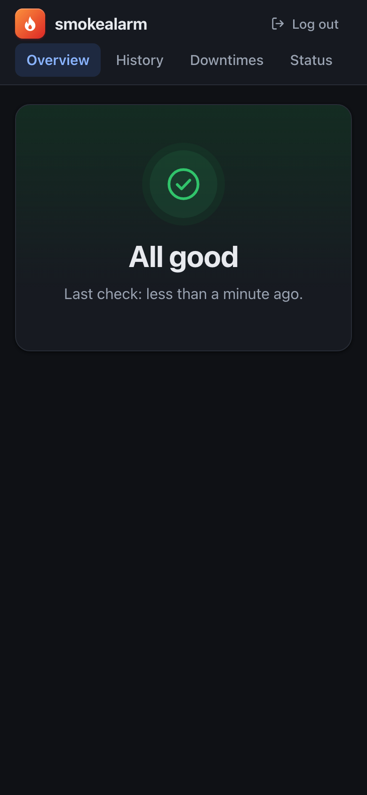
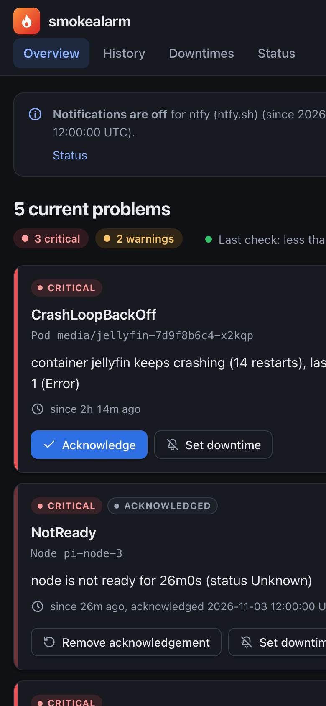
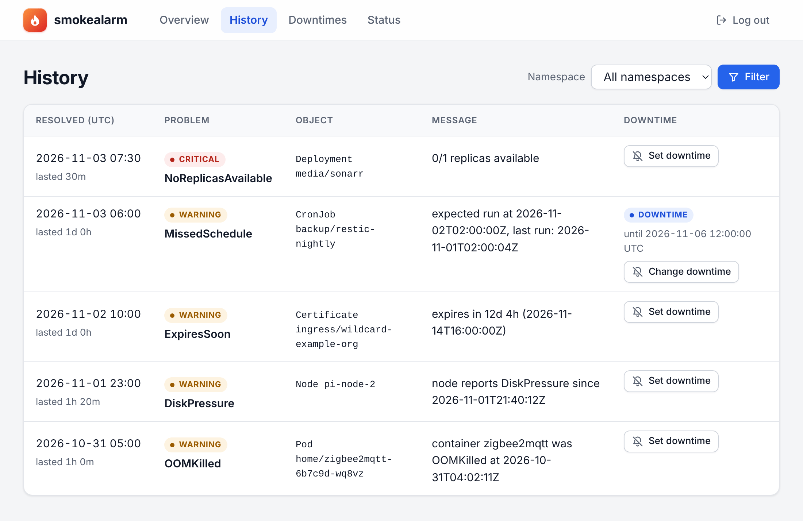
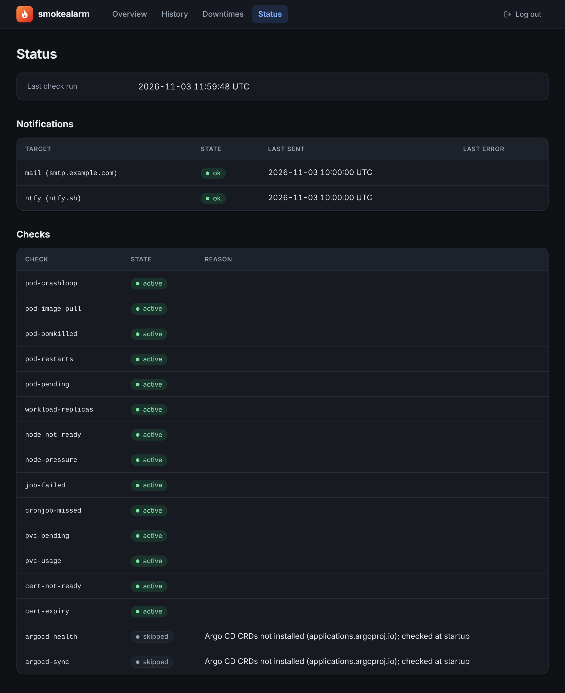

# How it works

## From problem to message

Every 30 seconds smokealarm runs all [checks](checks.md) against its in-memory copy of the cluster state and compares the result with the previous run.

A new problem starts as **pending**. If it is still there after `SMOKEALARM_ALERT_AFTER` (2 minutes by default), it becomes **firing** and is reported. Once it has been gone for `SMOKEALARM_RESOLVE_AFTER` (5 minutes by default), it is **resolved** and reported again. A problem that disappears before the first wait is over is never reported at all.

If a problem gets worse (warning to critical), it is reported again once the critical state has lasted `SMOKEALARM_ALERT_AFTER`. Everything that changed in one run goes out as a single mail or chat message.

For critical problems that stay open you can ask for reminders with `SMOKEALARM_CRITICAL_REPEAT_INTERVAL`, see [Notifications](notifications.md#mail). Warnings are never repeated.

[ARCHITECTURE.md](../ARCHITECTURE.md) describes how this is built.

## The web interface

The overview shows what is firing right now, critical problems first. For each problem you see the object, the reason, the message from the cluster and how long it has been going on. From there you can acknowledge a critical problem or set a downtime. When nothing is wrong, the page just says "All good".

The pages reload every 30 seconds and work on a phone. Light or dark mode follows your system setting.

<p>
  
  &nbsp;
  
</p>

The history lists resolved problems, newest first, and can be filtered by namespace. They are kept for 30 days by default (`SMOKEALARM_RETENTION`). You can set a downtime from here too, for a problem that keeps coming back.



The status page shows when the checks last ran, every notification target with the time of its last message and its last error, and every check. If a check can't run, for example because Argo CD isn't installed, the reason is next to it.



A fourth page lists the running downtimes and lets you end them early. The screenshots show made-up data.

## Acknowledging a problem

If you already know about a critical problem, press **Acknowledge** on the overview. The problem stays on the page with a mark and sends no more reminders. Only firing critical problems can be acknowledged; warnings aren't repeated anyway.

The mark lasts until the problem is resolved or until you remove it. You are always told when it is resolved, even if the first mail never went out. A first mail that is still waiting, for example during a mail server outage, is dropped when you acknowledge the problem. With several recipients, the others then only hear about it from the "resolved" mail.

If an acknowledged problem drops to a warning and then becomes critical again, it stays acknowledged and nothing is sent. If it comes back after it was resolved, that is a new alarm with a new mail.

**Remove acknowledgement** takes it back, and the problem behaves like any other again. An overdue reminder, or a first mail that was held back, goes out in the next run, unless a downtime is running. If the problem is only a warning at that moment, nothing is sent until it is critical again, and only then can you acknowledge it again.

An acknowledgement covers one problem, identified by its key: check, object and reason. Only `pvc-usage`, `cert-expiry` and `workload-replicas` keep their key when the reason changes. For the other checks a new reason counts as a new problem. So does a new object name, such as a pod that its Deployment recreated. The new problem gets its own mail and is not acknowledged.

## Downtimes

A downtime silences one problem, warning or critical, until a fixed date and time, for example during planned work or while something flaps. You set it from the overview or, if the problem is resolved right now, from the history. The **Downtimes** page lists the running ones, and you can end them early there. Times are entered and shown in the [time zone](#time-zone) you configured (UTC by default), like in the mails, and the end must be in the future. A new downtime for the same problem replaces the old one.

While a downtime runs, the problem sends nothing: no first mail, no reminder and no "resolved". It stays visible in the web UI with a mark.

When the downtime ends (on time or early) and the problem is still there, you get a mail in the next run, and the reminder interval starts from that mail. If the problem went away during the downtime, nothing is sent, not even afterwards. If it comes back after the end, it is a new alarm with a new mail. If the check can't run at the moment the downtime ends, for example because the kubelet doesn't answer, the mail waits until it runs again.

Downtimes and acknowledgements work together like this: while a downtime runs, it wins, so an acknowledged problem that goes away during a downtime sends no "resolved". The acknowledgement outlasts the downtime, though: if the problem is still there when the downtime ends, no mail is sent, and "resolved" is reported later.

A downtime covers exactly one problem, with the same rules as an acknowledgement: same check, object and reason. A new reason is a new problem, except for `pvc-usage`, `cert-expiry` and `workload-replicas`, and so is a new object name. In practice: **a pod recreated by its Deployment gets a new name, so a downtime on its `pod-crashloop` problem no longer covers it, and it sends mail as usual.** A downtime on the Deployment's `workload-replicas` problem keeps working, but it does not silence the problems of the pods themselves.

## Time zone

All times the web interface, the mails and the chat messages show are in one time zone, set with `SMOKEALARM_TIME_ZONE` (Helm `config.timeZone`), for example `Europe/Zurich`. The default is UTC. The zone is named in the column headers and in the downtime form, and mails and chat messages end their times with its abbreviation (`CET`, `CEST`). The time you enter in the downtime form is read in this zone. On the night the clocks change, a time that does not exist or exists twice is read as one of the two possible moments, within an hour of what you typed; check the end on the Downtimes page.

Only the display changes. smokealarm stores and compares times as absolute points in time, so changing the zone never changes when a problem fires or resolves. The JSON of the webhook stays in UTC, because programs read it.

## When a node is down

A node that fails takes its pods with it, and soon its Deployments, StatefulSets and DaemonSets miss replicas. smokealarm reports the node and holds the rest back.

The mail subject starts with the node, for example `[smokealarm] NODE DOWN: pi-2`, with other changes counted after it: `[smokealarm] NODE DOWN: pi-2 (+ 1 new problem, 1 resolved)`. The body starts with a section **NODE DOWN**, and chat messages start with "Node down:". Up to three nodes are named; the rest are counted.

Problems caused by the node are not reported while it is down, however long that takes. That covers pods on the node, and Deployments, StatefulSets and DaemonSets that miss no more replicas than they have pods on the node. The NotReady message lists them as "Affected" (as far as the target would hear about them), a reminder lists the current ones, and the overview shows them grouped below the node.

When the node is back, or the node no longer explains a held-back problem (say a DaemonSet that now fails on the healthy nodes too), that problem gets the usual `SMOKEALARM_ALERT_AFTER` from then on. Pods are usually ready again within that time, so all you get is the "resolved" of the node. A problem that lasts longer is reported on its own.

Some things are not held back. Pods that have no node yet (Pending, for example because the other nodes have no room for them) are a problem of their own and reported as usual. A problem that was already reported before the node went down carries on as before, with its reminders and its "resolved".

The node's own annotations decide about its alarm, not those of the pods on it. You can silence a test node with `smokealarm.gagaschu.github.io/ignore: "true"`, or send its alarm elsewhere with the [routing](routing.md) annotations. Its consequences are held back all the same, so a test node that fails doesn't alarm through its pods either.

```
kubectl annotate node pi-test smokealarm.gagaschu.github.io/ignore=true
```

A node counts as down when its Ready condition is `False` or `Unknown`, the same as for the `node-not-ready` check. Whether a problem is held back is decided per problem in every run: a Deployment that only misses its pod on the failed node is held back, while one of its pods that crashes on another node is reported. If `node-not-ready` is switched off, nothing is held back, because nobody would hear about the node. A node that is removed from the cluster counts as back.

## When the API cannot be read

smokealarm works on its own copy of the cluster, which the Kubernetes API keeps up to date. If those updates stop, the copy gets old and nothing looks wrong. smokealarm watches for this.

The check `api-connection` reports a critical problem once the API server hasn't answered, or a watch has been failing, for 3 minutes. Together with `SMOKEALARM_ALERT_AFTER` that makes 5 minutes by default, so a restart of the API server doesn't cause an alarm. The message names the last error.

If nothing can be read, all other checks count as unknown. Their problems stay as they are and send no reminders, and the status page gives the reason. They are judged again as soon as there is fresh data; new problems stay unseen until then. If only a part fails (a missing permission, a deleted CRD), the other checks run as usual and only the alarm tells you about it. Findings about the failing part may be out of date.

The overview shows a notice with the start time at the top and no longer says "All good". `/readyz` does not change, because a new pod wouldn't help.

How long it takes depends on the cause. A removed permission doesn't end a watch that is already open; it only shows when that watch ends, which takes 5 to 10 minutes. The notice then comes after 8 to 13 minutes and the alarm after 10 to 15 (with `SMOKEALARM_ALERT_AFTER` at 2 minutes). When the API server answers again after an outage, the outage is over at once. If it answers but some watches still fail, each of them counts as working again 2 minutes after its last error, because Kubernetes' client library doesn't report that a watch recovered. The notice and the alarm can therefore last up to 2 minutes longer than the failure, and if all watches are affected, the other checks stay paused for that time too. If a watch keeps failing for a lasting reason after the API server is back, its 3 minutes start over.

The alarm can only go out if the notification target is reachable without the cluster. Like every other problem, it is resolved after `SMOKEALARM_RESOLVE_AFTER`. If smokealarm is restarted during an outage, it can't start until the API is back, and the pod keeps restarting until then.
