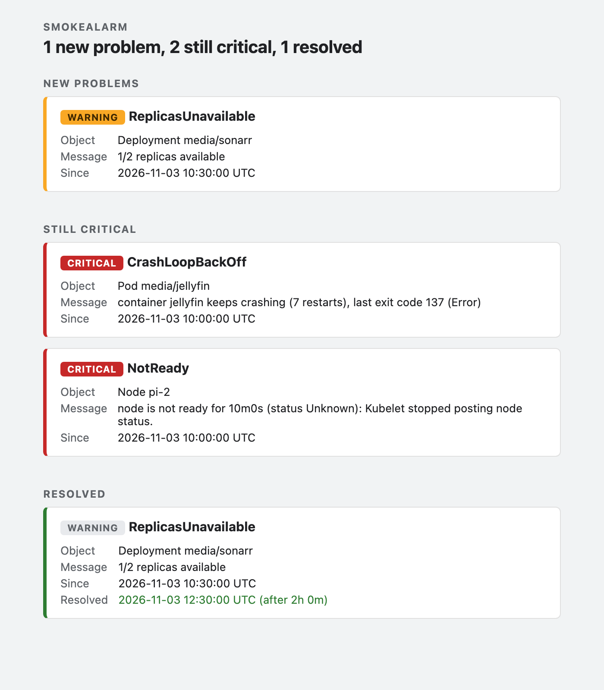

# Notifications

smokealarm can send to mail, [ntfy](#ntfy), [Telegram](#telegram), [Slack](#slack), [Microsoft Teams](#microsoft-teams) and a generic [webhook](#webhook), in any combination. Without any of them, notifications only go to the log.

Every target that is set up gets every notification, unless you [route](routing.md) them. The targets only decide *where* a notification goes. `SMOKEALARM_ALERT_AFTER`, the combined message per run, reminders, acknowledgements and downtimes work the same for all of them, and wherever these docs say "mail", the same applies to every target.

## How targets keep track

Each target remembers on its own what it has been told. If one is down, say Telegram for an hour, only that one is tried again in the next runs (also after a restart), and the others don't get anything twice. Each target also has its own reminder clock, which runs from its own last message.

A target you add later doesn't get the history. In its first run it hears about every problem that is firing and not acknowledged, as if it had just learned about them. A target you remove is forgotten; if you add it back, it counts as new.

The first start after upgrading from a version without targets takes over what the old version already reported, so nothing is sent twice. A target you add in that same step only hears what comes next.

## Switching a target off

On the status page, every target has a **Switch off** button. Use it when a target is not to be bothered for a while, for example a chat during planned work, while the other targets keep working. It switches off one target only; each Telegram chat is its own target, so you switch off one chat at a time. The log-only fallback (used when no target is set up) has no button.

While a target is off, it gets nothing: no first message, no reminder and no "resolved". The other targets are not affected. The overview names every target that is off, with the time it was switched off, and links to the status page, also when everything else is fine. A target stays off until you switch it on, also across restarts. There is no automatic end.

**Switch on** works like the end of a [downtime](how-it-works.md#downtimes), for this one target. It takes effect in the next run, so it can take until then; the status page says "being switched on" in the meantime. What is still firing and not acknowledged is reported as new, as if the target had just learned about it. What ended while the target was off stays silent, and so does a problem that is already gone but waits for `SMOKEALARM_RESOLVE_AFTER`. Acknowledged problems and problems in a downtime stay silent, as everywhere else. If the connection to the Kubernetes API is incomplete, a check cannot run or the usage of a volume could not be measured in that run, switching on waits until it can be done safely, so that nothing is reported that may be gone.

If you press **Switch off** while a target is waiting to be switched on, it stays off. A target you remove from the configuration forgets that it was off; if you add it back, it counts as new and is on.

## Secrets and network

Tokens and webhook URLs are secrets: whoever has one can post to your channel. The Helm chart keeps them in its Secret (or reads them from `existingSecret`), never as plain values in the Deployment. They never show up in the log, in error messages or on the status page. The status page only shows the name of the target, such as `slack`, `webhook`, `ntfy` or `telegram (chat -1001234567890)`.

All URLs must use `https`. Plain `http` is accepted for `localhost`, and for the webhook and the ntfy server also with `SMOKEALARM_NOTIFY_ALLOW_HTTP=true` (chart: `notifications.allowHttp`), for a relay inside the cluster. smokealarm doesn't follow redirects; a webhook that answers with one is reported as an error. The pod needs outgoing HTTPS to the services you use. `HTTPS_PROXY` is honored.

Discord, Matrix, Pushover, Gotify, PagerDuty and other services have no built-in target. Point the [webhook](#webhook) at a relay such as [Apprise](https://github.com/caronc/apprise-api) or [n8n](https://n8n.io) that forwards to them.

## Mail

Setting an SMTP host turns mail on:

```yaml
smtp:
  host: smtp.example.com
  port: 587
  tls: starttls            # starttls, tls (port 465) or none (local testing only)
  from: smokealarm@example.com
  to: [me@example.com]
  username: smokealarm     # optional; stored in the Secret together with the password
  password: "..."
```

A mail has an HTML part, which mail programs show, and the same content as plain text for everything else:



The text part looks like this:

```
Subject: [smokealarm] CRITICAL: CrashLoopBackOff media/jellyfin

1 new problem

NEW PROBLEMS

[CRITICAL] CrashLoopBackOff
  Object:  Pod media/jellyfin
  Message: container jellyfin keeps crashing (7 restarts), last exit code 137 (Error)
  Since:   2026-11-03 10:00:00 UTC

Details: https://smokealarm.example.com
```

A problem that went away is listed under RESOLVED with its last severity and how long it lasted:

```
RESOLVED

[WARNING] VolumeAlmostFull
  Object:   PersistentVolumeClaim plex/backup-tar
  Message:  87.0% full (9.5 TiB of 10.9 TiB used)
  Since:    2026-11-08 03:00:44 CET
  Resolved: 2026-11-08 03:04:14 CET (after 3m)
```

The wording and layout of both parts can be changed with [message templates](message-templates.md). With your own `mail.tmpl` and no `mail.html.tmpl`, mails are sent as text only.

If one run finds several changes, the subject is a count (`[smokealarm] 3 new problems, 1 resolved`) and the body lists all of them, critical problems first. A problem you were already told about triggers a new mail if it becomes critical.

To be reminded of critical problems that are still open, set `SMOKEALARM_CRITICAL_REPEAT_INTERVAL` (chart: `config.criticalRepeatInterval`). Each one is then reported again as `[smokealarm] STILL CRITICAL: ...` once its last report is that old. Warnings are not repeated.

If the mail server is down, smokealarm tries again in the next run, even after a restart.

## Chat messages

ntfy, Telegram, Slack and Teams get a short message: the mail subject as the headline, one line per problem with object, reason and since when, and the link to the web UI (`SMOKEALARM_BASE_URL`). You can change the wording and layout with [message templates](message-templates.md).

```
[smokealarm] 2 new problems, 1 resolved

New:
- CRITICAL Pod media/jellyfin: CrashLoopBackOff (since 2026-11-03 10:00 UTC)
- WARNING Deployment media/sonarr: ReplicasUnavailable (since 2026-11-03 10:30 UTC)
Resolved:
- Node pi-2: NotReady (since 2026-11-03 10:00 UTC, resolved 2026-11-03 12:30 UTC)

https://smokealarm.example.com
```

If there are more problems than fit into one message, the last line says `… and 12 more, see <link>`. The limits are 4096 bytes for ntfy and Telegram, 3000 characters for Slack and about 26 KB for the whole Teams card.

## ntfy

[ntfy](https://ntfy.sh) sends push notifications to phones and browsers. You subscribe to a *topic* in the app, and smokealarm publishes to it.

1. Pick a topic name that is hard to guess, for example `smokealarm-` followed by random characters (`openssl rand -hex 8`). On the public server ntfy.sh, anybody who knows the topic can read along, so treat the name like a password.
2. Subscribe to it in the ntfy app or on <https://ntfy.sh/app>.
3. Set it in the chart:

```yaml
notifications:
  ntfy:
    topic: smokealarm-3f9c2a17b04e5d68   # goes into the Secret
    # server: https://ntfy.example.org   # your own server; empty means https://ntfy.sh
    # token: tk_...                      # an access token, if the server needs one
```

On a self-hosted server with access control, create a token (`ntfy token add <user>`) and set `token` (`SMOKEALARM_NTFY_TOKEN`). It is sent as `Authorization: Bearer`.

The message gets the mail subject as its title and a click action that opens the web UI. Its priority depends on what it reports: **urgent** for a new critical problem, so it gets through; **high** for reminders only; **default** for new warnings; **low** if everything in it is resolved.

## Telegram

1. Talk to [@BotFather](https://t.me/BotFather) in Telegram, send `/newbot` and answer the questions. At the end you get a token like `123456789:AAH...`.
2. Start a chat with your new bot and send it any message. For a group, add the bot to the group and send a message there. For a channel, add the bot as an administrator.
3. Find the chat id: open `https://api.telegram.org/bot<token>/getUpdates` in a browser and look for `"chat":{"id":...}`. Groups have negative ids (`-100...`). A public channel can also be given as `@channelname`.
4. Set both in the chart. You can list several chat ids; each chat is retried on its own. Put the ids in quotes, because Helm turns bare numbers into floats, and the chart refuses those:

```yaml
notifications:
  telegram:
    botToken: "123456789:AAH..."              # goes into the Secret
    chatIds: ["-1001234567890", "987654321"]
```

The message is plain text, so names with `_` or `<` need no escaping. The token is part of the request URL, which smokealarm never logs.

## Slack

1. Create a Slack app at <https://api.slack.com/apps> ("From scratch"), open **Incoming Webhooks**, switch them on and choose **Add New Webhook to Workspace** with the channel.
2. Copy the webhook URL (`https://hooks.slack.com/services/...`) into the chart:

```yaml
notifications:
  slack:
    webhookUrl: https://hooks.slack.com/services/T000/B000/XXXX   # goes into the Secret
```

The message has the subject as its header and the problem list below it.

## Microsoft Teams

Teams is reached through a **Power Automate Workflows** webhook. Microsoft switched off the old Office 365 connector webhooks (`https://<tenant>.webhook.office.com/...`), and smokealarm refuses such a URL at startup.

1. In Teams, open the channel, choose **⋯ → Workflows** and pick the template **Post to a channel when a webhook request is received**.
2. Follow the steps (team and channel). At the end, copy the URL it shows (`https://...logic.azure.com/workflows/...` or `https://...powerplatform.com/...`).
3. Set it in the chart:

```yaml
notifications:
  teams:
    webhookUrl: "https://prod-01.westeurope.logic.azure.com/workflows/..."   # goes into the Secret
```

smokealarm posts an Adaptive Card with the subject, the problem list and a button that opens the web UI. Workflows answers `202 Accepted`, and the card can take a few seconds to show up.

## Webhook

The webhook posts every notification as JSON to a URL of your choice, for your own automation or for a relay to services without a built-in target.

```yaml
notifications:
  webhook:
    url: https://relay.example.org/hooks/smokealarm   # goes into the Secret
    header: "Authorization: Bearer <token>"           # optional, goes into the Secret
```

`header` (`SMOKEALARM_WEBHOOK_HEADER`) is one extra header of the form `Name: value`, usually for authentication. Any `2xx` answer counts as delivered. The request is a `POST` with `Content-Type: application/json`:

```json
{
  "version": 1,
  "subject": "[smokealarm] 1 new problem, 1 resolved",
  "base_url": "https://smokealarm.example.com",
  "counts": { "new": 1, "reminders": 0, "resolved": 1 },
  "new": [
    {
      "key": "pod-crashloop/Pod/media/jellyfin/CrashLoopBackOff",
      "check": "pod-crashloop",
      "severity": "critical",
      "object": { "kind": "Pod", "namespace": "media", "name": "jellyfin" },
      "reason": "CrashLoopBackOff",
      "message": "container jellyfin keeps crashing (7 restarts), last exit code 137 (Error)",
      "since": "2026-11-03T10:00:00Z",
      "resolved_at": null,
      "affected": []
    }
  ],
  "reminders": [],
  "resolved": [
    {
      "key": "node-not-ready/Node//pi-2/NotReady",
      "check": "node-not-ready",
      "severity": "critical",
      "object": { "kind": "Node", "namespace": "", "name": "pi-2" },
      "reason": "NotReady",
      "message": "node is not ready for 10m0s (status Unknown): Kubelet stopped posting node status.",
      "since": "2026-11-03T10:00:00Z",
      "resolved_at": "2026-11-03T12:30:00Z",
      "affected": []
    }
  ]
}
```

About the fields:

- `version` only changes if a field is removed or changes its meaning. New fields can be added at any time, so ignore the ones you don't know.
- `new`, `reminders` and `resolved` are always lists, possibly empty. `reminders` are critical problems that are still open (see `SMOKEALARM_CRITICAL_REPEAT_INTERVAL`).
- `key` identifies a problem across messages. The same key in `resolved` ends what an earlier `new` started.
- `affected` is always a list. For a `node-not-ready` problem in `new` or `reminders` it holds the problems the node holds back (`object` and `reason`, see [When a node is down](how-it-works.md#when-a-node-is-down)); otherwise it is empty.
- `since` and `resolved_at` are RFC 3339 in UTC, whatever `SMOKEALARM_TIME_ZONE` says, so read times from them. `subject` and `message` are the texts the other targets get, so a time inside them, such as the expiry date of a certificate, is in `SMOKEALARM_TIME_ZONE`. `resolved_at` is `resolved_at` is `null` unless the problem is resolved. `namespace` is empty for cluster-scoped objects such as nodes. `base_url` is empty if `SMOKEALARM_BASE_URL` is not set.

The webhook doesn't use the message templates; its JSON format stays fixed.
